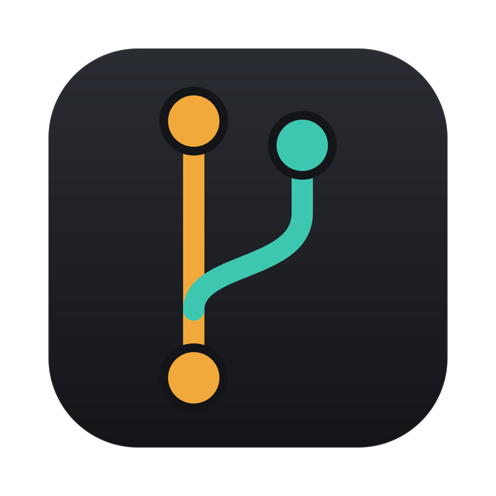
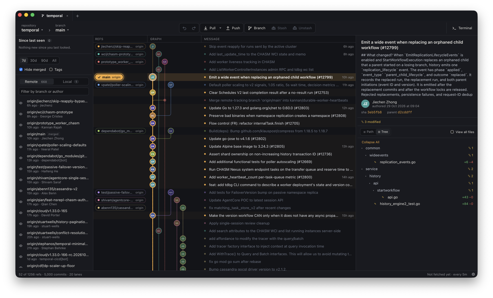
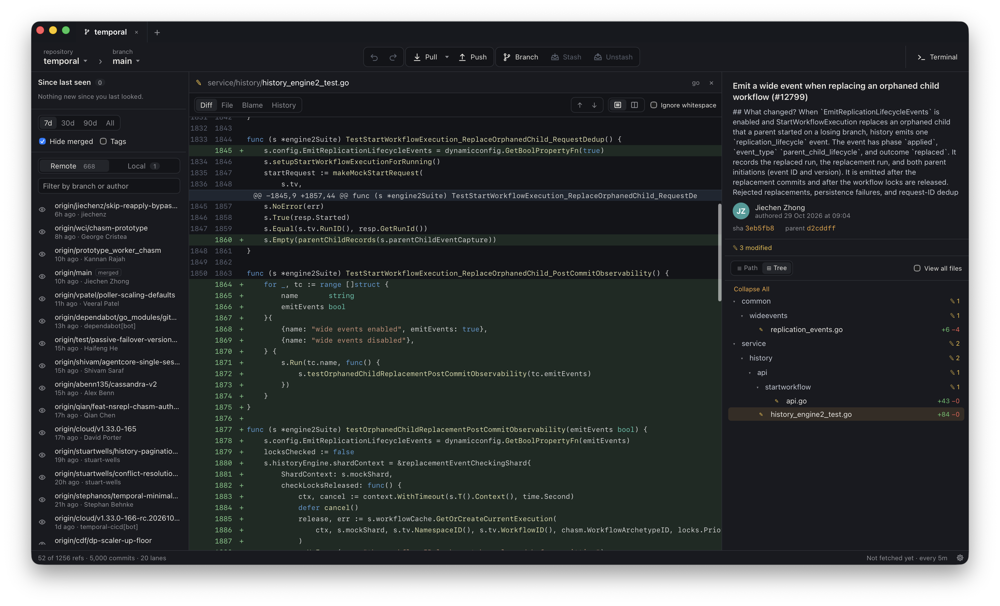

<div align="center">



# frk

**Every branch in one graph — and what changed since you last looked.**

A fast, lightweight desktop Git client for teams that push a lot of branches.

[](#install)
[](https://tauri.app)
[](rust-toolchain.toml)
[](package.json)
[](#roadmap)

<br />



</div>

## Why frk

Most Git clients are built around *your* branch. On a busy repository the work
that matters is often someone else's: a branch that appeared overnight, a
colleague's force-push, a fix that landed on `main` while you were heads-down.

frk draws **every active branch at once**, keeps a **“since last seen” list**
of what moved until you acknowledge it, and lights up **the branch you are on**
so it never gets lost in the crowd. It does this in a ~5 MB app that uses the
system webview instead of bundling a browser.

## Features

**See everything**
- 🌳 **All-branches graph**: every active branch as its own lane, author avatars
  on the nodes, local and remote labels merged into one chip.
- 🔦 **HEAD first**: your branch's history is drawn bright and bold, the rest
  recedes.
- 🎚️ **Filters that keep it readable**: active in the last 7 / 30 / 90 days,
  hide merged, tags, solo or hide any branch.

**Stay aware**
- 🔔 **Since last seen**: new, moved, force-pushed and deleted branches, with
  the commits and authors that arrived, until you mark them seen.
- 🔄 **Auto fetch** on an interval you choose; your own pushes are never
  reported back to you as news.

**Get work done**
- ✍️ **Commit panel**: stage and unstage per file or all, discard, amend, skip
  hooks, sign-off, ⌘↩ to commit.
- 🖱️ **Right-click everything**: checkout, branch, reset, revert, rename,
  delete, tag, copy links, push and open a pull request.
- ↩️ **Undo / Redo** for checkout, branch, reset, tag, stash and commit.
- 🗂️ **Repository tabs**, a toolbar for pull / push / stash / unstash, and a
  Terminal button.

**Review**
- 🔍 **Full-page file view**: unified or split diffs with syntax highlighting
  and word-level changes, whole-file view, blame, and history across renames.

<p align="center">
  
</p>

## Install

frk is early and not yet published as a signed download. Build it from source
(a few minutes):

```sh
git clone https://github.com/mragungsetiaji/frk.git
cd frk
make install
make dmg            # → target/release/bundle/dmg/frk_<version>_<arch>.dmg
```

Open the .dmg and drag **frk** into Applications, or run `make install-app` to
copy it there directly. You need Rust, Node 22, pnpm and git; see
[CONTRIBUTING.md](CONTRIBUTING.md#setup).

> [!NOTE]
> Local builds are signed ad hoc, which is enough on the Mac that built them.
> frk targets Windows too, but it has not been built or tested there yet.

## Usage

Open a repository from the folder button or the `+` tab, or pass one on launch:

```sh
make dev REPO=~/code/my-repo
```

| | |
|---|---|
| Select a commit | click, or <kbd>↑</kbd> / <kbd>↓</kbd> in the graph |
| Act on a commit or branch | right-click it, in the graph or the sidebar |
| Open a file | click it in the commit panel; <kbd>Esc</kbd> closes it |
| Commit | select the **Uncommitted changes** row, stage, write a summary, <kbd>⌘</kbd> <kbd>↩</kbd> |
| Resize columns | drag the column edges; double-click to reset |
| Settings | the ⚙ in the bottom-right corner |

## How it stays fast

| | |
|---|---|
| Lane layout | in Rust, once per filter change: under 1 ms for 1.4k commits |
| Graph drawing | one `<canvas>`, repainted from the rows on screen only |
| Long lists | graph, diffs, files and blame are all virtualized |
| Git access | the git CLI: your config, credentials, hooks and `commit-graph` just work |
| Footprint | 4.9 MB app, 2.4 MB .dmg, system webview |

The details, including how lanes are assigned and why write actions are typed
rather than passed through, are in [docs/design.md](docs/design.md).

## Roadmap

- [x] All-branches graph, HEAD highlighting, filters
- [x] “Since last seen” with auto fetch
- [x] Right-click actions with undo
- [x] File view: diff, file, blame, history
- [x] Commit panel
- [ ] Stage individual hunks and lines
- [ ] Interactive rebase: drop, reorder and reword older commits
- [ ] Merge conflict resolution
- [ ] File-system watcher instead of refresh-on-focus
- [ ] Signed, notarized releases; tested Windows builds

## Contributing

Issues and pull requests are welcome. [CONTRIBUTING.md](CONTRIBUTING.md) covers
setup, the dev loop (including a browser-only UI mode and faster rebuilds with
[blaze](https://github.com/indexable-inc/blaze)), and what a change should look
like.

## Acknowledgements

frk stands on [Tauri](https://tauri.app), [React](https://react.dev),
[Prism](https://prismjs.com), [TanStack Virtual](https://tanstack.com/virtual)
and [Zustand](https://zustand.docs.pmnd.rs).

## License

No license has been chosen yet. Until one is, the code is all rights reserved.

frk is an independent project. It is not affiliated with, endorsed by or
sponsored by GitKraken, Axosoft or any other Git client vendor; product names
belong to their owners.
